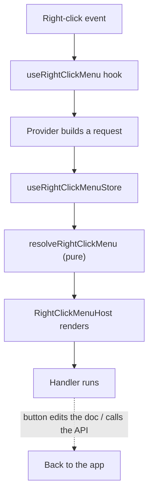

# Right-click context menu

A single, app-wide right-click menu built with MUI `MenuList` / `MenuItem`.
Right-clicking the editor, a directory row, or any card opens the menu,
with buttons that fit whatever you right-clicked.

## comments
minimal - ascii only, 2 lines max for normal comments, 10 lines for component/class doc strings. no ` ticks and no -- dashes. understandable for humans

## Why one menu for the whole app

Right now there is no right-click menu anywhere in the app. Each page
would normally build its own, and every one of them would need copy/paste,
shortcut hints, and a "where does this menu appear" answer. Instead we
build the menu **once** and let each page say which buttons it wants.

Two rules keep this from turning into spaghetti:

1. The **store** only remembers "a menu is open, here is its position,
   here is what was requested". It never decides what to render.
2. A **pure function** turns a request into a list of rows. No React, no
   MUI, no side effects — so it is trivially testable.

---

## The seven layers

Read top to bottom: each layer only knows about the one above it.



| # | Layer | File | Job |
|---|---|---|---|
| 1 | Store | `src/src/zustand/useRightClickMenuStore.ts` | Remembers open/closed + position + the request |
| 2 | Pure resolver | `src/src/components/RightClick/resolveRightClickMenu.ts` | Request → list of rows (testable) |
| 3 | Button catalogue | `src/src/components/RightClick/rightClickMenuButtons.tsx` | Every built-in button: label, icon, shortcut, handler |
| 4 | Renderer | `src/src/components/RightClick/RightClickMenu.tsx` | Turns rows into `Paper > MenuList > MenuItem` |
| 5 | Host + hook | `RightClickMenuHost.tsx`, `useRightClickMenu.ts` | Mounted once in `App.tsx`; the `onContextMenu` handler |
| 6 | Presets | `rightClickMenuPresets.ts` | Pure builders, e.g. "these are the table buttons" |
| 7 | Providers | `EditorRightClickMenu.tsx`, `DirectoryItemMenu.tsx`, … | One per surface; each declares its own buttons |

---

## 1. The store

`useRightClickMenuStore` is deliberately **dumb**. It holds:

- `isOpen` / `position` — where the menu goes
- `request` — what the caller asked for
- `disabledButtons` — app-wide kill switches (e.g. paste in read mode)

### The request object

```ts
interface RightClickMenuRequest {
  position: { x: number; y: number };
  /** Logical target: a note id, directory id, "table:12". */
  targetId?: string;

  /** Which built-in buttons to show, in which order. */
  buttons: RightClickButtonId[];

  /** Per-button patch: relabel, swap icon, change shortcut, replace handler. */
  overrides?: Partial<Record<RightClickButtonId, RightClickButtonOverride>>;

  /** Caller rows rendered before the built-in buttons. */
  leadingComponents?: RightClickMenuRow[];

  /** Any React you want appended after the built-ins. */
  extraComponents?: RightClickMenuRow[];

  /** A hover submenu attached to one button (used by "Insert"). */
  submenus?: Partial<Record<RightClickButtonId, RightClickSubmenu>>;
}
```

> **Why config per right-click instead of a global registry?**
> A shared mutable registry is a hidden dependency: to know what a card
> will show, you must read global state, and tests leak into each other.
> Per-request config is just input → output, so the resolver stays pure.

---

## 2. The pure resolver

`resolveRightClickMenu(request, disabled, registry)` returns the rows to
render. It:

- drops hidden and globally-disabled buttons
- merges `overrides` into the built-in catalogue
- inserts a `<Divider>` wherever a gap in the ids appears
- appends `extraComponents` last

Icons are passed through as opaque values, so a test can feed strings and
assert on ordering without pulling in MUI.

---

## 3. Built-in buttons

| id | Label | Shortcut | Default action |
|---|---|---|---|
| `copy` | Copy | `ctrl+c` | Editor selection (HTML + text); else the target's text |
| `paste` | Paste | `ctrl+v` | Read clipboard → insert at cursor |
| `cut` | Cut | `ctrl+x` | Copy, then delete the selection |
| `insert` | Insert | — | Opens the hover submenu |
| `table` | Table | — | Table operations (editor only) |
| `edit` | Edit | — | Provided by the page |
| `delete` | Delete | — | Provided by the page |
| `favourite` | Favourite | — | `useFavouritesStore` |

Each button carries a `handler` that returns a boolean. `false` means
"nothing to do here" — the row renders **greyed out** rather than
vanishing.

### Copy and paste are always there

They live in the catalogue with sensible defaults and appear in **every**
preset. When there is no editor and no text to act on, the row is visible
but disabled.

> Visible-but-disabled beats conditionally-absent: a menu whose contents
> jump around on every right-click is disorienting.

### Shortcut rendering

Shortcut hints use the existing
[`KeyboardShortcut`](src/src/utils/renderShortcut.tsx) component, so they
render as key chips and respect macOS vs. Windows automatically. No new
shortcut renderer.

---

## 4. Rendering

Follows the MUI composition exactly, wrapped in `Menu` so the browser can
flip it away from the window edge:

```tsx
<Menu anchorEl={anchor} open={isOpen} onClose={close}>
  <Paper>
    <MenuList autoFocusItem>
      {rows.map((row) =>
        row.kind === "divider" ? <Divider key={row.key} /> : (
          <MenuItem key={row.key} disabled={row.disabled}>
            <ListItemIcon>{row.icon}</ListItemIcon>
            <ListItemText>{row.label}</ListItemText>
            {row.shortcut && (
              <Typography variant="body2" color="text.secondary">
                <KeyboardShortcut shortcut={row.shortcut} />
              </Typography>
            )}
          </MenuItem>
        ),
      )}
    </MenuList>
  </Paper>
</Menu>
```

`<RightClickMenuHost />` is mounted once in `App.tsx`, next to
`InfoDisplay`, following the existing global-overlay convention.

### The hover submenu

A nested `Menu` opens on `onMouseEnter` and closes after ~150 ms so the
pointer can travel diagonally without losing it.

MUI's built-in `SubmenuList` is not installed (only `x-tree-view` is), so
this is ~30 lines of our own code rather than a new dependency.

---

## 5. Using it

```tsx
const menu = useRightClickMenu();

<Box
  onContextMenu={menu.onContextMenu(event, {
    targetId: note.id,
    buttons: ["copy", "paste", "edit", "delete"],
  })}
/>
```

Contexts only ever **build a request**. No API calls, no dialogs, no
mutation logic inside a component.

| Provider | Attached to | Buttons |
|---|---|---|
| `EditorRightClickMenu` | editor surface | `copy paste cut` + table ops + `Insert ▸` |
| `DirectoryItemMenu` | `DirectoryItem` | `copy paste edit delete` |
| `FolderCardMenu` | home directory card | `copy paste favourite edit delete` |
| `NoteCardMenu` | main-page note card | `copy paste edit delete` |

---

## Editor behaviour

### Element menus and highlight

The contextmenu handler resolves what the pointer is over
(`resolveEditorContextTarget`), places the editor selection on it, and
decorates it with a primary-colour outline via the
`EditorContextHighlight` extension. The outline is cleared when the menu
closes. Three kinds get their own entries:

| Kind | Entries |
|---|---|
| Image | Copy image link, Delete image |
| Code block | Copy code, Delete code block |
| Table | every command in the shared table catalogue (below) |

Element rows are caller rows (`leadingComponents`, so they sit at the
top of the menu, above the generic copy/paste buttons) and carry a
`handler`, so a command is just `{ id, label, icon, handler }`. Rows
with a `submenu` also render a right chevron so it is obvious a nested
menu is behind them.

The contextmenu listener is attached to the editor DOM in the **capture
phase**. That is the reliable path for node views (images, code blocks):
the capture listener runs before Firefox's native menu, and
`stopImmediatePropagation` keeps ProseMirror's bubble-phase handler from
opening the menu a second time.

### Table options

When you right-click a table, table buttons appear. Detection reuses
`resolveEditorContextTarget` plus `analyseSelection(editor.state)` from
[`bubbleMenuStrategies.ts`](src/src/components/Editor/bubbleMenuStrategies.ts),
which reports the selection kind and which rows/columns are hit.

The root table menu is:

| Row | Contents |
|---|---|
| Delete table | `deleteTable()` |
| Rows ▸ | Insert above/below, move up/down, delete |
| Columns ▸ | Insert left/right, move left/right, delete |
| Clear cell(s) | `clearCells(editor)` |

The menu is built from the single command catalogue in
[`tableCommands.ts`](src/src/components/Editor/tableCommands.ts). The
bubble menu and the right-click menu both consume it, so there is one
run implementation per operation. Deleting a row/column pluralises from
the selection, and a whole-table selection offers only **Delete table**.

### Insert submenu

Hovering **Insert** opens a second menu:

| Item | Action | Already exists? |
|---|---|---|
| Table | `insertTable({ rows: 3, cols: 3, withHeaderRow: true })` | yes (slash command) |
| Image | `editorMenuStore.openFileDialog()` | **yes — counter bus** |
| LaTeX | `editorMenuStore.openLatexDialog()` | **yes — counter bus** |
| Code block | `setCodeBlock()` | yes (slash command) |

Two of the four come free from the existing
[`editorMenuStore`](src/src/zustand/editorMenuStore.ts) counter pattern.

### Two landmines to respect

1. **Handler identity.** `useEditor` has deps `[noteId, ydoc]`. An inline
   `handleContextMenu` closure would rebuild the editor config on every
   render — the exact `flushSync` storm already documented in the repo.
   Fix: a `contextMenuOpenerRef` (mirroring the existing
   `latexOpenerRef`) holding a stable dispatcher, with `handleContextMenu`
   itself memoised on empty deps.

2. **No transaction re-renders.** `shouldRerenderOnTransaction: false`.
   Table-active state must come from `useEditorState`, never from a
   re-render of the editor subtree.

---

## Reusable mutations

Today edit/delete is welded to the *currently viewed* directory
(`useDirectoryFeatures`). To serve cards on three different pages, we
extract id-parameterised mutations and have the hook delegate — no
behaviour change, no duplicated logic:

```ts
// New: api/queries/useDirectoryMutations.ts
useDirectoryDelete()  // delete(id) → DELETE + removeDirectory + invalidate
useNoteDelete()       // already exists as useDeleteNote()

// DirectoryFeatures.hook.tsx shrinks to:
const handleDeleteDirectory = () => deleteDirectory(currentNode.getId());
```

Directory **edit** reuses the existing `CreateDirectoryModal` with
`mode="edit"` and a `directoryId`.

Note **edit** becomes a rename via `useUpdateNote` for cards, and opens
the full editor from the directory page.

---

## Build order

Phases 1–2 deliver a working app-wide menu before any page is wired up,
and every phase leaves the suite green. Detailed tasks live at the end of
this document.

---

## Decisions

Settled before implementation.

| # | Question | Decision |
|---|---|---|
| 1 | Where does the directory edit dialog live? | **A — one shared store-driven host.** A `directoryDialog` request in `useRightClickMenuStore` (or a sibling store) opens `CreateDirectoryModal` from any surface. Matches the `editorMenuStore` counter pattern instead of mounting the modal three times. |
| 2 | Delete confirmation | **A — always `ConfirmationModal`.** Uniform with the existing directory flow. Directories keep the cascade preview; notes get a plain confirm. |
| 3 | Read-only editor | **A — copy only, paste disabled.** Copy is a legitimate read-mode action; paste is not, so it renders greyed out rather than hidden. |
| 4 | Note "edit" from a card | **A — rename via `useUpdateNote` on cards, open the full editor from the directory page.** Each surface does what the user came there to do. |
| 5 | Mobile | **A — hide the menu entirely on touch devices.** Gated by `useBreakpoint`; long-press already selects directory items. |
| 6 | Clipboard images | **B — implement the `read()` path.** Clipboard images route through the existing `uploadAttachment` extension, so pasting an image copied elsewhere behaves like a local upload. |

### Consequences of decision 6

`navigator.clipboard.read()` needs a user gesture and a permission prompt,
and only Chromium supports it today. So the paste handler:

- reads `text/plain` first — the common case, works everywhere;
- additionally calls `read()` and picks the first `image/*` item when
  available, converting it to a `File` and handing it to
  `uploadAttachment`;
- silently skips the image path when `read` is unsupported or denied, so
  the plain-text paste still succeeds.

### Consequences of decision 1

A second counter-bus store. Worth it because directory edit/delete is
needed from four surfaces (directory title menu, directory row menu, home
card menu, main-page card menu), and one dialog host keeps a single form
state instead of four.

---

## File summary

**New**

- `src/src/zustand/useRightClickMenuStore.ts`
- `src/src/components/RightClick/types.ts`
- `src/src/components/RightClick/resolveRightClickMenu.ts`
- `src/src/components/RightClick/rightClickMenuButtons.tsx`
- `src/src/components/RightClick/rightClickMenuPresets.ts`
- `src/src/components/RightClick/RightClickMenu.tsx`
- `src/src/components/RightClick/RightClickMenuHost.tsx`
- `src/src/components/RightClick/useRightClickMenu.ts`
- `src/src/components/RightClick/EditorRightClickMenu.tsx`
- `src/src/components/RightClick/editorClipboard.ts` (extracted, shared)
- `src/src/components/Editor/tableCommands.ts` (shared command catalogue)
- `src/src/components/Editor/tableOperations.ts` (clearCells + move helpers)
- `src/src/components/Editor/editorIcons.tsx` (icon-name -> icon map)
- `src/src/components/Editor/editorContextTarget.ts` (pointer -> element)
- `src/src/components/Editor/editorContextHighlight.ts` (outline decoration)
- `src/src/pages/DirectoryView/DirectoryItemMenu.tsx`
- `src/src/pages/Home/FolderCardMenu.tsx`
- `src/src/pages/MainPage/NoteCardMenu.tsx`
- `src/src/api/queries/useDirectoryMutations.ts`

**Changed**

- `src/src/App.tsx` — mount `<RightClickMenuHost />`
- `src/src/pages/NotePage/NoteEditorCore.hook.tsx` — `handleContextMenu`
- `src/src/pages/NotePage/NoteRichEditor.tsx` — mount the editor provider
- `src/src/pages/DirectoryView/DirectoryItem.tsx` — attach the menu
- `src/src/pages/Home/FolderCardView.tsx` — attach the menu
- `src/src/pages/MainPage/NoteCard.tsx` — attach the menu
- `src/src/components/Editor/TextSelectionBubbleMenu.tsx` — reuse
  `editorClipboard` instead of its private copy
- `src/src/pages/DirectoryView/DirectoryFeatures.hook.tsx` — delegate to
  the shared mutation

**Not changing**

- `DirectoryMenu.tsx` — the existing 3-dot title menu keeps working; the
  right-click menu is additive.

---

## Tasks

Ordered so each task is independently verifiable. T1–T3 are already
written; everything below is the remaining work.

### Phase 1 — Foundation (no UI)

**T1. `src/src/components/RightClick/types.ts`** — done

- `RightClickButtonId` union, `RightClickMenuRequest`, `RightClickButtonOverride`,
  `RightClickMenuRow`, `RightClickSubmenu`, `ResolvedMenuEntry`,
  `RightClickButtonRegistry`.

**T2. `src/src/zustand/useRightClickMenuStore.ts`** — done

- `openMenu` / `closeMenu` / `repositionMenu` / `setButtonEnabled`.
- `disabledButtons` as a `Set` — membership is the only question asked.
- `openDirectoryDialog` counter bus (decision 1).

**T3. `src/src/components/RightClick/resolveRightClickMenu.ts`** — done

- Pure `(request, registry, disabled) → ResolvedMenuEntry[]`.
- Catalogue key order is canonical, so callers cannot produce menus that
  reflow per call site.
- Divider emitted *before* the row that follows the gap.

**T4. `resolveRightClickMenu.test.ts`** — 17 cases covering ordering,
kill switches, `canRun` gating, field-level overrides, `shortcut: null`
vs. `undefined`, divider gaps, and `extraComponents`.

- Verify: `cd src && pnpm vitest run src/components/RightClick`

### Phase 2 — It renders

**T5. `rightClickMenuButtons.tsx`** — the catalogue

- `copy` / `paste` / `cut` / `insert` / `table` with icons + shortcuts.
- `edit` / `delete` / `favourite` declared **handlerless** so they render
  disabled until a provider supplies one.
- `canRun` probes that read the target id and editor lazily.

**T6. `RightClickMenu.tsx`** — the renderer

- `Paper > MenuList > MenuItem` per the reference composition.
- `ListItemIcon` / `ListItemText` / `Typography` layout.
- Shortcut column renders `<KeyboardShortcut>` — **not** a hand-rolled
  string (requirement 2).
- Nested `Menu` submenu on `onMouseEnter`, ~150 ms close delay.
- `MenuItem` with `hasSubmenu` closes the parent instead of firing.

**T7. `RightClickMenuHost.tsx`** — the single mounted surface

- Subscribes to the store, resolves rows, renders `RightClickMenu`.
- Reads `request.position` as a virtual-anchored `anchorEl` so MUI handles
  viewport flipping.
- `useBreakpoint()` gate — **hide entirely on touch** (decision 5).

**T8. `useRightClickMenu.ts`** — the ergonomic entry point

- `onContextMenu(event, spec)` → builds the request, calls `preventDefault`,
  `openMenu`.
- Touch gate lives here so no surface repeats it.

**T9. `App.tsx`** — mount `<RightClickMenuHost />` next to `InfoDisplay`.

**T10. `RightClickMenu.test.tsx`**

- Copy and paste are present in every preset.
- Shortcut hint renders as key chips.
- Disabled rows render greyed, not absent.

### Phase 3 — Clipboard

**T11. `editorClipboard.ts`** — extract from `TextSelectionBubbleMenu`

- Move `writeFormattedClipboard`, `getSelectionText`, `getSelectionHtml`
  out of `TextSelectionBubbleMenu.tsx` into a shared module.
- Update `TextSelectionBubbleMenu` to import from the new file. **Delete
  its private copies** — one implementation, two consumers.

**T12. `copyEditorSelection(editor)`**

- Reads selection html+text, writes both, falls back to
  `copyToClipboard` from `InfoStore`.
- Resolves `useActiveNoteStore.getState().editor` lazily when no editor is
  passed, so cards work with no provider.

**T13. `pasteIntoEditor(editor)` — decision 6, the `read()` path**

- Read `text/plain` first (works everywhere).
- Then attempt `navigator.clipboard.read()`, pick the first `image/*`.
- Convert the blob to a `File`, hand to `uploadAttachment`.
- Guard the whole image path in try/catch: unsupported or denied → the
  text paste already succeeded, so swallow and return.

**T14. Wire `copy` / `paste` / `cut` defaults** into T5's catalogue.

- `cut` = copy, then `deleteSelection` — only when the editor is editable.

### Phase 4 — The editor

**T15. `EditorRightClickMenu.tsx`**

- Wires `handleContextMenu` via a **stable ref**, mirroring `latexOpenerRef`.
  This is the `flushSync` storm guard — an inline closure would rebuild the
  editor config every render.
- Table-active state via `useEditorState`, never a re-render
  (`shouldRerenderOnTransaction: false`).

**T16. `rightClickMenuPresets.ts` — table buttons**

- Detect via `analyseSelection(editor.state)`; read `cell.rowIndices` /
  `cell.columnIndices` for correct multi-row/column delete labels.
- Commands: `addRowBefore/After`, `addColumnBefore/After`, `deleteRow`,
  `deleteColumn`, `deleteTable`, `clearCells`.
- Singular vs. plural labels driven by the selection size.

**T17. `rightClickMenuPresets.ts` — insert submenu**

- Table → `insertTable({ rows: 3, cols: 3, withHeaderRow: true })`
- Image → `editorMenuStore.openFileDialog()`
- LaTeX → `editorMenuStore.openLatexDialog()`
- Code block → `setCodeBlock()`

**T18. Read-mode gating — decision 3**

- `editMode === false` → copy/paste rows only, paste disabled.
- Assert no table or insert row renders in read mode.

**T19. `NoteEditorCore.hook.tsx` + `NoteRichEditor.tsx`** — wire it in.

### Phase 5 — Mutations and the shared dialog

**T20. `api/queries/useDirectoryMutations.ts`**

- `useDirectoryDelete()` → `DirectoryApi.delete` + `removeDirectory` +
  invalidate, returning `Promise<boolean>`.
- Extracted from `useDirectoryFeatures` with **no behaviour change**.

**T21. `useDirectoryFeatures.hook.tsx`** — delegate to T20.

- Existing directory tests must stay green untouched.

**T22. `DirectoryDialogHost.tsx` — decision 1**

- Listens to `directoryDialogRequest`, mounts the existing
  `CreateDirectoryModal` in `create` / `edit` mode.
- One form state for all four surfaces.

**T23. Note mutations**

- `useDeleteNote` already exists but has **zero callers** — add the first.
- Rename via `useUpdateNote` for cards (decision 4).
- `ConfirmationModal` on every delete (decision 2).

### Phase 6 — The surfaces

**T24. `DirectoryItemMenu.tsx`** — buttons `copy paste edit delete`

- Root directory: edit and delete disabled, matching `DirectoryMenu`'s
  existing root protection.

**T25. `FolderCardMenu.tsx`** — `copy paste favourite edit delete`

**T26. `NoteCardMenu.tsx`** — `copy paste edit delete`

**T27. Attach the menus** in `DirectoryItem.tsx`, `FolderCardView.tsx`,
`NoteCard.tsx`.

- `stopPropagation` so the right-click never also triggers the card's own
  click (i.e. never navigates).
- Cards that are `useDraggable` must not begin a drag on right-click.

**T28. Component tests** for all three surfaces.

- Delete opens the confirmation dialog, not a direct API call.
- Root directory disables destructive rows.

### Phase 7 — Verification

**T29. `pnpm lint`** from `src/`.

**T30. `pnpm vitest run`** — full suite green, no snapshot churn in
existing tests.

**T31. Manual pass** — right-click on: editor text, editor table,
directory row, home card, note card. Confirm the browser menu never
appears, and that ⌘C / ⌘V still work natively.

---

## Definition of done

- [x] Right-click anywhere opens the MUI menu; the browser menu never shows
- [x] Copy and paste present in **every** menu (requirement 3)
- [x] Shortcut hints render via `KeyboardShortcut` (requirement 2)
- [x] Store allows configuring buttons, overriding callbacks, injecting
      arbitrary components (requirement 4)
- [x] Table right-click shows table operations (requirement 5.1)
      (delivered as the Table submenu)
- [x] Insert opens a hover submenu with table / image / latex / codeblock
      (requirement 5.2)
- [x] Directory rows have delete + edit (requirement 6.1)
- [x] Home and Main cards have delete + edit (requirement 7)
- [ ] No new `flushSync` warnings; no editor re-render storm
- [ ] `pnpm lint` and `pnpm vitest run` both clean

Remaining:

- The `flushSync` / re-render item needs the manual pass (T31); the
  stable `contextMenuOpenerRef` and the absence of any per-transaction
  subscription in the editor menu are the design guards.
- `pnpm vitest run` is green (76 files / 762 tests) and the build passes.
  Repo-wide `pnpm lint` still reports roughly 450 pre-existing errors in
  files unrelated to this feature; every file touched here lints clean.