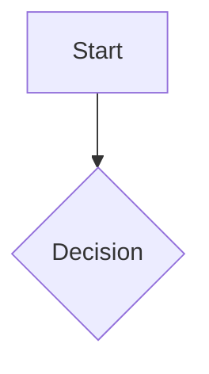

## Editor Components (Tiptap + MUI)

This directory contains reusable building blocks for the rich-text editor used in:

- the modal editor flow in `NoteEditModal`
- the full-page note editor flow in `NotePage`

The components here are intentionally split by responsibility: editor shell, formatting menus, slash commands, table controls, and theme wrappers.

## Component Overview

### Core editor shell

- `NoteEditModal.tsx`
	- Modal-based editor implementation.
	- Sets up Tiptap extensions and markdown mode toggling (`Rich` <-> `Source`).
	- Wires in static and bubble controls (`EditorStaticMenu`, `EditorBubbleMenu`).

- `ThemedEditorBox.tsx`
	- Visual wrapper around `EditorContent`.
	- Applies theme-aware styles for table borders, inline code, and editor chrome.
	- Wraps children with `CodeBlockThemer`.

- `CodeBlockThemer.tsx`
	- Theme-aware code block styling (including `hljs-*` syntax token classes).

### Formatting controls

- `EditorStaticMenu.tsx`
	- Always-visible toolbar above editor content.
	- Includes:
		- `BoldItalicMenu`
		- `TableButtonGroup`
		- source mode toggle
		- read-only toggle

- `EditorBubbleMenu.tsx`
	- Basic contextual bubble menu.
	- Hidden while table node is active.
	- Currently renders `BoldItalicMenu`.

- `FormattingPanel.tsx`
	- Right-rail formatting panel for the full-page editor.
	- The insert-block group starts with a Mermaid button (`AccountTree`
	  icon), which inserts the same code block as `/mermaid`.

- `BoldItalicMenu.tsx`
	- Toggle buttons for bold, italic, strike.
	- Uses `useEditorState` to keep visual state synced with selection marks.

- `TextSelectionBubbleMenu.tsx`
	- Contextual menu for selected text.
	- Includes bold, italic, strike, inline code, highlight, and clear formatting.
	- Visibility rules:
		- editor must be editable
		- feature must be enabled
		- editor must be focused
		- selection must be non-empty and non-whitespace
	- Publishes visibility to shared store (`editorMenuStore`) so competing table hover controls can be suppressed immediately.

### Slash command controls

- `SlashCommandMenu.tsx`
	- Floating menu shown when a reachable text block contains a `/` query.
	- Filters and ranks commands by the typed query.
	- `Enter` or `Tab` activates the top-ranked command. Commands without
	  arguments run immediately; commands with arguments open the
	  Discord-style composer.
	- `Escape`, whitespace, or a bare `-` typed right after the slash
	  hides the menu without deleting the typed text.
	- Current command set:
		- `/table`
		- `/bullet-point`
		- `/enumerate`
		- `/heading-1`
		- `/heading-2`
		- `/heading-3`
		- `/codeblock [language]` (optional, defaults to `plaintext`)
		- `/mermaid` (also matches `diagram`, `flowchart`, `graph`)
		- `/details`
		- `/cite` (also matches `quote`)
		- `/bold`
		- `/italic`
		- `/strike`
		- `/latex inline`
		- `/latex block`
	- `/bold`, `/italic`, and `/strike` toggle text formatting. When a
	  format is active, the menu shows `/<command> off`.
	- `/latex inline` and `/latex block` open the existing LaTeX dialog
	  with the requested initial type, then insert the result with
	  `insertInlineMath` or `insertBlockMath`.
	- `/mermaid` inserts a code block tagged `language: "mermaid"`
	  pre-filled with a starter flowchart (`MERMAID_TEMPLATE`), so there is
	  no language argument to pick. See “Mermaid diagrams” below.
	- Commands can be invoked from any editable editor context, including
	  lists, tables, code blocks, and selections containing text after the
	  slash query.

- `SlashCommandComposer.tsx`
	- Inline Discord-style argument composer, rendered as an ephemeral
	  ProseMirror widget (`SlashCommandComposerExtension`) after the
	  completed `/command` text.
	- Each argument is a bordered chip: argument name on a darker
	  background on the left, value input on the right. Required arguments
	  are marked with `*`.
	- `Enter` runs the command when all required arguments have a value
	  (typed value or `defaultValue`). If an autocomplete menu is open,
	  the first `Enter` selects the highlighted suggestion.
	- `Tab` accepts the highlighted suggestion or focuses the next argument.
	- `ArrowUp`/`ArrowDown` navigate suggestions; `Escape` closes the
	  suggestions first, then the composer.
	- `Backspace` in an empty argument removes that argument; in the first
	  argument it closes the composer, leaving the `/command` text intact.
	- Autocomplete menus appear above the focused chip. Sources may be a
	  static option list or an async callback (useful for server searches).
	- The composer never becomes document content or collaboration state.

### Table controls

- `TableControlls.tsx`
	- Exports `TableWithControls` (custom table extension with React node view).
	- Adds hover controls for add/remove rows and columns.
	- Suppresses table hover controls while text selection menu is active.

- `TablePinnedMenu.tsx`
	- Bubble menu for table operations when selection is inside a table.
	- Not always mounted in every editor surface, but available for table-focused workflows.

- `TableColumnMenu.tsx`
	- Bubble menu shown above the active table column.
	- Column-level operations: move left, move right, delete.

- `TableButtonGroup.tsx`
	- Static toolbar group with quick table insertion button.

### Mermaid diagrams

A Mermaid diagram is stored as a plain fenced code block tagged
`mermaid` - there is no custom node type:

````text

````

That keeps markdown round-tripping and other markdown consumers working
with no Mermaid-specific handling; `CustomCodeBlock` already parses and
writes the fence.

- `mermaid/mermaidBlock.ts`
	- `MERMAID_LANGUAGE`, `MERMAID_TEMPLATE`, `isMermaidLanguage`,
	  `insertMermaidBlock`.
	- Single source of truth for the language tag and the starter diagram,
	  shared by `/mermaid` and the formatting-rail button.

- `mermaid/mermaidRenderer.ts`
	- `renderMermaid(code, theme)` wraps the lazily imported `mermaid`
	  package (`securityLevel: "strict"`) and resolves to SVG markup.
	- The import is dynamic, so Mermaid stays out of the initial bundle
	  until the first diagram renders. Import this module instead of
	  `mermaid` directly so the preview stays mockable in tests (jsdom has
	  no layout engine).
	- `resetMermaidRenderer()` drops the cached module and theme config.

- Code-block node view
	- Renders a live SVG preview below the source while editing. Below,
	  not above: the preview renders asynchronously, and a height change
	  above an active selection makes browsers (Firefox in particular)
	  keep painting the caret at its previous screen position.
	- Hides the source entirely in read-only editors, so view mode shows
	  the diagram only.
	- Invalid diagrams surface an inline error instead of a preview.
	- Observes the preview box for size changes and forces a DOM selection
	  rewrite (`mermaid/mermaidPreviewResize.ts`). The preview renders
	  asynchronously, so without that nudge the browser keeps painting the
	  caret at its old screen position after the diagram (or its inline
	  parse error) below the diagram grows or shrinks. Re-running
	  ProseMirror's own selection sync is not enough: it skips writing a
	  selection that already matches its state.

- `lowlight.ts`
	- Registers `mermaid` with the `plaintext` grammar purely so
	  `CodeBlockLowlight` never reaches the costly `highlightAuto` path for
	  these blocks; highlighting the diagram source adds nothing.

## Shared state and interaction rules

- Shared Zustand store: `editorMenuStore.ts`
	- `isTextSelectionMenuOpen`
	- `setTextSelectionMenuOpen`

Why this exists:

- Prevents visual/menu collisions between text-selection formatting and table hover controls.
- Enables immediate coordination across independently mounted menu components.

## Usage patterns

### In the full-page note editor

`NotePage` mounts:

- `TextSelectionBubbleMenu`
- `SlashCommandMenu`
- `ThemedEditorBox`
- `TableWithControls` as the table extension

### In the modal editor

`NoteEditModal` mounts:

- `EditorStaticMenu`
- `EditorBubbleMenu`
- `ThemedEditorBox`

and supports markdown source editing through a source-mode `TextField`.

### Find / replace

The full-page note editor has a VS Code-style find/replace widget
(`src/pages/NotePage/FindReplaceBar.tsx`) floating at the bottom of the
viewport. It is opened with `Ctrl/Cmd+F`; `Ctrl/Cmd+H` opens it with the
replace row already expanded. Replace is only available while the note
is editable (view mode keeps find but disables replace).

Supporting pieces:

- `findReplace.ts`
	- Pure matcher/replacer shared by the rich and source surfaces.
	- Handles match case, whole word, regex, capture expansion and
	  preserve case.
- `FindReplaceExtension.ts`
	- Tiptap/ProseMirror plugin that resolves matches to document
	  positions and paints the `find-replace-match` decorations (the
	  active hit also gets `--active`). Recomputes on every transaction.
- `FindReplaceBar.tsx`
	- The widget UI and the `Ctrl+F`/`Ctrl+H` capture.
	- Drives the rich editor through `FindReplaceExtension` and the
	  source `NoteSourceEditor` textarea through its imperative handle.

## Adding new slash commands

In `SlashCommandMenu.tsx`, extend the `slashCommands` array with:

- `id`: stable command identifier (also used in `/id` display)
- `label`: user-facing name
- `keywords`: search aliases
- `getCommandName(editor)`: optional state-aware command name
- `arguments`: optional array of argument definitions. Commands with at
  least one argument open the composer instead of running immediately.
- `run(editor, args)`: command implementation; `args.values` maps argument
  names to resolved values, and `args.value(name)` is a convenience getter.

Argument definitions (`SlashCommandArgument` from
`slashCommandTypes.ts`):

- `name`: chip label and key in `args.values`
- `description`: help text shown above suggestions
- `required`: blocks execution until a value (or default) exists
- `defaultValue`: fallback value; also satisfies `required`
- `autocomplete`: static `{ value, label?, description? }[]` list or an
  async callback receiving `{ editor, command, argument, query, values,
  signal }`. Use the `signal` to abort server requests when the query
  changes.
- `allowCustomValue`: defaults to `true`

Guidelines:

- Clear the slash line before applying block commands (`clearSlashLine(editor)`).
- Use `clearSlashCommand(editor)` for inline toggles so surrounding text is preserved.
- Use Tiptap mark toggles for formatting commands rather than inserting marker text.
- Use `getCommandName` to report active state, such as `/bold off`.
- Read argument values via `args.value("name")` and define sensible
  defaults for optional arguments.
- For LaTeX variants, open the shared LaTeX dialog and insert the
  confirmed result with the matching Mathematics command.
- For Mermaid, call `insertMermaidBlock(editor)` and reuse
  `MERMAID_LANGUAGE` from `mermaid/mermaidBlock.ts` instead of
  hard-coding the language tag or the starter template.
- Keep `run` deterministic and side-effect free beyond editor updates.
- Prefer chainable Tiptap commands with `.focus()`.

## Troubleshooting

- Bubble menu appears too early:
	- Check `isTextSelectionMenuVisibleNow` guard logic in `TextSelectionBubbleMenu.tsx`.
	- Ensure editor focus and non-empty selection checks remain intact.

- Table controls overlap text-selection menu:
	- Verify `setTextSelectionMenuOpen` updates fire on `selectionUpdate` and `transaction`.
	- Verify `TableControlls.tsx` is reading `isTextSelectionMenuOpen` from store.

- Slash commands do not appear:
	- The slash query must belong to the current text block and remain
	  reachable from the caret or selection.
	- The command menu is available in table/list/taskList/codeBlock contexts
	  and with a non-empty text selection after the slash query.
	- A selection that starts before the slash is treated as an unrelated
	  navigation and does not open the menu.

## Notes

- File naming currently includes `TableControlls.tsx` (double "l"). Keep import paths consistent unless a dedicated rename refactor is performed.
- 