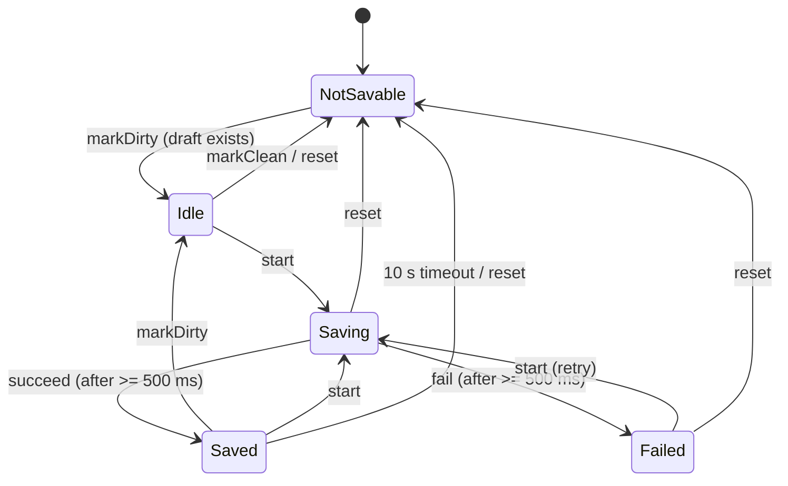

# Note save state machine

The save control is driven by a small State-pattern machine in
`noteSaveMachine.ts`. The store mirrors its status into `saveStatus`; the
Save button only renders the active state.

## States

| State | Meaning | Save button |
| --- | --- | --- |
| `NotSavable` | No local changes are pending. | “No Changes”, starting a save is a no-op |
| `Idle` | A draft exists and can be saved. | “Save” |
| `Saving` | A save is in flight. The minimum window keeps “Saving” visible for at least 500 ms, even when the request finishes instantly. | “Saving” |
| `Saved` | The last save succeeded. Stays visible for 10 seconds, then returns to `NotSavable`. | “Saved now”, primary color |
| `Failed` | The last save failed. The error snackbar is shown; a new save can be started to retry. | “Failed” |

## Notes

- The draft store is the dirty flag: `markDirty` when a draft exists,
  `markClean` when it is cleared.
- Multiple ticks during an in-flight save are queued by the store. Once the
  current request settles, the follow-up request reads the latest editor
  content and moves `Saved`/`Failed` back to `Saving`.
- `reset` is used when the active note changes and always clears timers.
